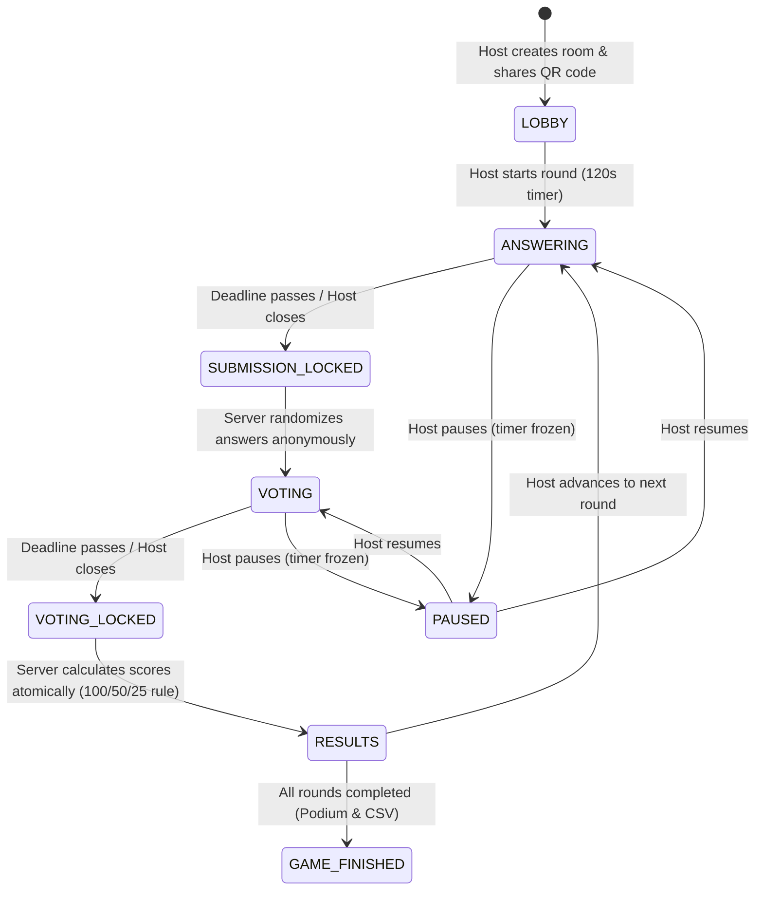

# PSYCH — Real-Time Multiplayer Party Game for E-Cell SVNIT

A mobile-first, server-authoritative live multiplayer game designed for campus events with 10–15+ simultaneous participants and 1 host controlling the game show from a dashboard or projector screen.

---

## 🎨 Tech Stack & Architecture

- **Frontend**: React 19, TypeScript, Vite, Tailwind CSS (v3 with custom Brutalist Comic Theme), Framer Motion, Lucide React, QRCode.react, Canvas-Confetti, Web Audio API Synthesizer.
- **Backend & Database**: Firebase Authentication (Anonymous Auth), Cloud Firestore (real-time listeners, transactions), Firebase Cloud Functions.
- **Visual Design**: Energetic Comic Brutalism — Yellow (`#FFD400`), Deep Black (`#101010`), Spider-Man Red (`#E62429`), Halftone dot textures, Angular web borders, and oversized typography.
- **Testing**: Vitest automated unit & integration test suites verifying 15-player simultaneous simulation, word bounds, self-vote prevention, ties, and scoring idempotency.

---

## 🕹️ Game Flow & State Machine



---

## 🏆 Scoring Rules (Section 10)

1. **Answer Points**: **100 points** per valid vote received by your anonymous answer. Self-votes are prohibited and never count.
2. **Voting Participation Points**: **25 points** awarded for casting a valid vote during the voting phase.
3. **Winner Bonus**: **50 points** awarded to the author(s) of the most-voted answer. In case of ties, **each tied winner receives 50 bonus points**.
4. **Formula**:
   $$\text{Round Score} = (\text{Votes} \times 100) + \text{Participation (25)} + \text{Winner Bonus (50)}$$
5. **Leaderboard**: Competition ranking (**1st, 2nd, 2nd, 4th**) with deterministic secondary ordering.

---

## 🚀 Step-by-Step Firebase Setup Guide

Follow these simple steps in the Firebase Console:

### Step 1: Create a Firebase Project
1. Go to [Firebase Console](https://console.firebase.google.com/) and click **"Add project"**.
2. Name it (e.g. `psych-svnit`). Disable Google Analytics if not needed, then click **Create Project**.

### Step 2: Enable Anonymous Authentication
1. In the left navigation, go to **Build** -> **Authentication** and click **Get Started**.
2. Under the **Sign-in method** tab, click **Anonymous**.
3. Toggle the **Enable** switch to ON and click **Save**.

### Step 3: Create Cloud Firestore
1. In the left navigation, go to **Build** -> **Firestore Database** and click **Create database**.
2. Choose a database location (e.g., `asia-south1` for Mumbai, closest to Surat/SVNIT).
3. Choose **Start in production mode** (our `firestore.rules` file contains the complete security model).

### Step 4: Register Web App & Get Config
1. In Project Overview, click the **Web icon (</>)** to register an app.
2. Give it a nickname (e.g., `psych-web`) and click **Register app**.
3. Copy the `firebaseConfig` keys into your `.env` file:
   ```env
   VITE_FIREBASE_API_KEY=AIzaSy...
   VITE_FIREBASE_AUTH_DOMAIN=psych-svnit.firebaseapp.com
   VITE_FIREBASE_PROJECT_ID=psych-svnit
   VITE_FIREBASE_STORAGE_BUCKET=psych-svnit.appspot.com
   VITE_FIREBASE_MESSAGING_SENDER_ID=...
   VITE_FIREBASE_APP_ID=1:...
   VITE_FIREBASE_MEASUREMENT_ID=G-...
   VITE_USE_FIREBASE_EMULATOR=false
   ```

### Step 5: Deploy Security Rules & Cloud Functions
Login to Firebase CLI in terminal and deploy:
```bash
firebase login
firebase use --add <your-project-id>
firebase deploy --only firestore:rules,firestore:indexes
```

---

## 🧪 Running Automated Tests

Run the test suite verifying all game logic, scoring, ties, and 15-player multiplayer concurrency:
```bash
npm test
```

Expected output:
```
✓ tests/multiplayerIntegration.test.ts (6 tests)
✓ tests/gameLogic.test.ts (12 tests)
Test Files  2 passed (2)
Tests       18 passed (18)
```

---

## 💻 Running Locally

Start the local development server:
```bash
npm run dev
```
Open [http://localhost:5173](http://localhost:5173) in your browser or phone on the same Wi-Fi.

---

## 📱 Routes & Features

- `/` — Landing page with hero, E-Cell SVNIT badge, scoring rules preview, and room creator modal.
- `/join` — Fast participant join route (prefills room code from QR scan).
- `/room/:roomCode` — Participant game interface adapting across all 8 phases.
- `/host/:roomCode` — Host control console (phase advancement, moderation, pause/resume, round restarts, CSV export).
- `/display/:roomCode` — High-contrast read-only projector view for classroom/auditorium screens.
- `/results/:roomCode` — Final leaderboard and CSV download route.

---

## 📋 Live Event Organizer Checklist

- [ ] **Host Device**: Use a laptop connected to the classroom projector with `/display/:roomCode` open.
- [ ] **Host Controls**: Open `/host/:roomCode` on the laptop or host phone.
- [ ] **QR Code**: Present the lobby QR code on the projector screen for students to scan.
- [ ] **Audio**: Sound effects are synthesized locally via Web Audio API and muted by default. Unmute on the projector laptop to play countdown ticks and reveal fanfares.
- [ ] **Backup**: Export final standings as CSV with one click on the Host dashboard at the end of the event.
